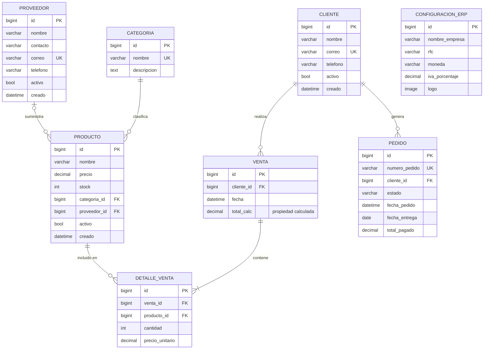

# Decisiones de Diseño — ERP Django
## Espiral 2 · Modelo Entidad-Relación

---

### D-01: Producto → Categoria usa on_delete=PROTECT

**Decisión:** No permitir borrar una categoría si tiene productos asociados.

**Alternativas consideradas:**
- `CASCADE`: borraría todos los productos de esa categoría (peligroso)
- `SET_NULL`: dejaría productos sin categoría (viola integridad de negocio)

**Consecuencia:** Para borrar una categoría, primero reasignar sus productos.
Esto es correcto: un ERP no debe perder histórico de productos.

---

### D-02: Producto → Proveedor usa on_delete=SET_NULL, null=True

**Decisión:** Un producto puede existir sin proveedor asignado.

**Justificación:** Productos fabricados internamente o de proveedor desconocido.
Al borrar un proveedor, los productos no desaparecen; quedan sin proveedor.

---

### D-03: Venta → Cliente usa on_delete=PROTECT

**Decisión:** No borrar un cliente con historial de ventas.

**Justificación legal:** El historial de ventas es un registro contable.
Borrar el cliente implicaría borrar evidencia fiscal.
Usar `activo=False` para "dar de baja" sin borrar datos.

---

### D-04: Venta.total es propiedad calculada (NO campo de BD)

**Decisión:** `total` se calcula en tiempo de ejecución, no se almacena.

```python
@property
def total(self):
    return sum(d.subtotal for d in self.detalles.all()) ´´´
   
**Justificación:** Almacenar `total` crearía dependencia transitiva
(viola 3FN: `total` depende de `DetalleVenta`, no de `Venta.id`).
Además, si se modifica una línea, el total calculado siempre es correcto.

**Advertencia de rendimiento:** Para dashboards con miles de ventas,
usar `annotate(total=Sum(...))` en lugar de la property.

---

### D-05: DetalleVenta → Producto usa on_delete=PROTECT

**Decisión:** No borrar un producto que tuvo ventas históricas.

**Justificación:** Los reportes de ventas históricas referencian productos.
Usar `activo=False` en Producto para "descontinuar" sin borrar.

---

### D-06: DetalleVenta.precio_unitario es campo almacenado

**Decisión:** Almacenar el precio al momento de la venta, no derivarlo
de `Producto.precio`.

**Justificación:** El precio de un producto puede cambiar después de
la venta. El histórico de ventas debe reflejar el precio real cobrado,
no el precio actual del producto.

**Implementación:** El `save()` del modelo captura el precio si no
se especifica:
```python
def save(self, *args, **kwargs):
    if not self.precio_unitario:
        self.precio_unitario = self.producto.precio
    super().save(*args, **kwargs)
```

---

### D-07: ConfiguracionERP como singleton

**Decisión:** Una sola fila de configuración global del sistema.

**Implementación:** Sobrescribir `save()` para que siempre use `pk=1`,
y en el admin, deshabilitar el botón "Agregar".

**Alternativa:** `django-constance` (configuración dinámica). Se evaluará
en la Espiral 7 cuando se implemente el dashboard.
```

---

## PARTE 4 — Diagrama ER en Mermaid y dbdiagram.io (35 min)

### 4.1 Crear `docs/diagramas/diagrama_er.md`

Este archivo es visible directamente en GitHub con el diagrama renderizado:

````markdown
# Diagrama Entidad-Relación — ERP Django
## Espiral 2 · Aprobado por: MC. Román Fernando López González
## Fecha de aprobación: ___/___/_____



## Cardinalidades

| Relación | Tipo | Descripción |
|---|---|---|
| Categoria → Producto | 1:N obligatorio | Un producto siempre tiene categoría |
| Proveedor → Producto | 1:N opcional | Un producto puede no tener proveedor |
| Cliente → Venta | 1:N | Una venta siempre tiene cliente |
| Cliente → Pedido | 1:N | Un pedido siempre tiene cliente |
| Venta → DetalleVenta | 1:N obligatorio | Una venta tiene al menos 1 línea |
| Producto → DetalleVenta | 1:N | Un producto puede aparecer en N ventas |

## Notas de diseño

- `Venta.total` es una **propiedad calculada**, no un campo de BD (decisión D-04)
- `DetalleVenta.precio_unitario` se almacena por integridad histórica (D-06)
- `ConfiguracionERP` es un **singleton** (siempre pk=1) (D-07)
- `Pedido` se implementa en la **Espiral 5 (W13-W15)**

## Firma de aprobación

| Rol | Nombre | Fecha | Observaciones |
|---|---|---|---|
| Desarrollador | [Nombre] | | |
| Asesor (PO) | MC. Román Fernando López González | | |

